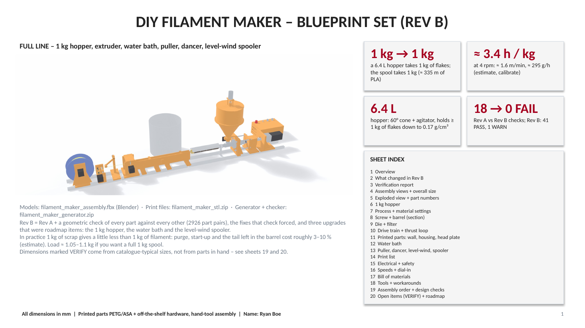

# DIY Filament Maker (Blueprint Set, Rev B)

A complete design for a desktop machine that melts plastic flakes (print scrap or bottles) and extrudes new 1.75 mm filament. The blueprint set has 20 dimensioned sheets, with printed parts in PETG/ASA plus off-the-shelf hardware, assembled with hand tools.

**Status:** Design complete (Rev B). Not yet built.

<!-- Export sheet 1 from the .pptx as a PNG and save it to images/01-overview.png -->

## Key numbers

| | |
|---|---|
| Capacity | 1 kg of flakes in, about 1 kg spool out (about 335 m of PLA) |
| Hopper | 6.4 L, 60 degree cone with agitator, holds 1 kg of flakes down to 0.17 g/cm3 |
| Throughput | About 295 g/h at 4 rpm (estimate, to be calibrated on the first run) |
| Heating | 4 PID-controlled zones, hard limit 280 C for phase 1 |
| Cooling | 474 mm water bath with pump and bucket |
| Spooling | Dancer arm + level-wind spooler driven by a stepper |

## The line

Scrap flakes (4 mm or smaller) -> dry -> hopper with agitator -> screw and barrel -> die with filter screen -> water bath -> puller -> dancer arm -> level-wind spooler.

## What Rev B added

Rev A was checked by testing the geometry of every part against every other part (2,926 pairs). That check found real conflicts, which drove the Rev B fixes (Rev A: 18 failures; Rev B: 41 pass, 1 warning). Rev B also added three upgrades that were on the roadmap: the 1 kg hopper, the water bath and the level-wind spooler.

## Contents

| Sheet | Topic |
|---|---|
| 1-3 | Overview, Rev B changes, verification report |
| 4-5 | Assembly views, overall size, exploded view with part numbers |
| 6-9 | Hopper, process and material settings, screw and barrel section, die and filter |
| 10-13 | Drive train and thrust loop, printed parts, water bath, puller, dancer and level-wind spooler |
| 14-17 | Print list, electrical and safety, speeds, bill of materials |
| 18-20 | Tools and workarounds, assembly order and design checks, open items (VERIFY) and roadmap |

Material starting setpoints are included for PLA, PETG, ABS/ASA, TPU, PET and PP/HDPE.

## Files

- `source/filament_maker_blueprint.pdf`: the full blueprint set, viewable right on GitHub
- `source/filament_maker_blueprint.pptx`: the editable blueprint set
- `models/filament_maker_assembly.fbx`: Blender assembly model
- `print-files/filament_maker_stl.zip`: 26 STL files (P01 to P26) for the printed parts
- `generator/`: the Python scripts that generate the parts, run the geometry check and build the deck (see its README), with Rev A and Rev B verification results in `generator/out/`

## About the generator

The whole design is parametric: every dimension lives in `generator/fm_params.py`. Changing a value and re-running the scripts rebuilds the 3D model, the STL files and the drawings, and the geometry checker (`fm_verify.py`) re-tests every part pair. The scripts need Python with Blender's `bpy`, plus `trimesh`, `manifold3d` and `shapely`.

## Safety notes from the design
Printed parts must stay below about 70 C, so the head plate and bearing housing should be checked with an IR thermometer on the first run. ABS/ASA fumes need ventilation.

## Related
The [shredder](../shredder/) prepares the flakes this machine uses.
