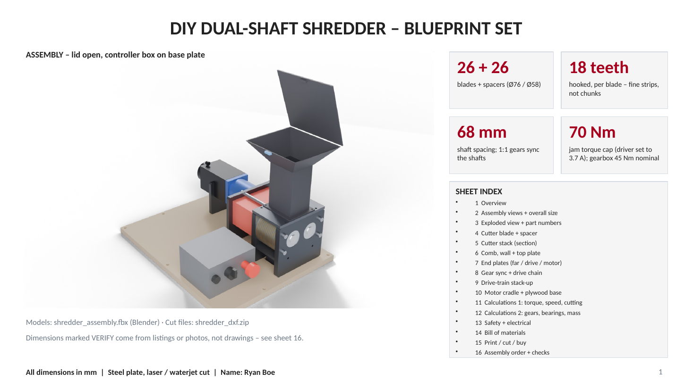

# DIY Dual-Shaft Shredder (Blueprint Set)

A dual-shaft shredder designed to cut plastic bottles and 3D print scrap into small strips for the [filament maker](../filament-maker/). The blueprint set has 16 sheets with the engineering calculations shown.

**Status:** Design complete. Not yet built. Dimensions marked VERIFY come from listings or photos and should be confirmed against the real parts (see sheet 16).

<!-- Export sheet 1 from the .pptx as a PNG and save it to images/01-assembly.png -->

## Key numbers

| | |
|---|---|
| Cutters | 26 blades + 26 spacers (76 mm / 58 mm diameter), 18 hooked teeth per blade |
| Shaft spacing | 68 mm, with 1:1 gears keeping the shafts in sync |
| Jam protection | 70 Nm torque cap (driver set to 3.7 A); gearbox rated 45 Nm nominal |
| Power | 60 V supply, stepper driver, about 314 W at the shaft (estimated) |
| Size | 518 mm long, 393 mm tall, on a 434 x 546 mm base plate |
| Safety | 140 mm funnel throat keeps hands away from the blades |

## Calculations included

- Torque chain from motor to coupler, with the weakest link identified (the 70 Nm coupler)
- Speed, power and pulse-rate points for the stepper driver
- Cutting force check by material: PET bottle, HDPE, PLA, ABS and acrylic
- Gear mesh stress (Lewis bending and contact) for two gear materials and face widths
- Shafts, bearings and mounting

## Files

- `source/shredder_blueprint.pdf`: the full blueprint set, viewable right on GitHub
- `source/shredder_blueprint.pptx`: the editable blueprint set
- `models/shredder_assembly.fbx`: Blender assembly model of the whole machine
- `models/parts_library.zip`: 32 individual part models (.fbx): blades, spacers, combs, gears, shafts, end plates, motor cradle, coupler, gearbox, motor, controller enclosure, e-stop and more
- `cut-files/shredder_dxf.zip`: 13 DXF files for cutting the plate parts (blades x26 at 3 mm, spacers x26, combs x26, walls x26, 20 mm gears, end plates, top/bottom plates, base plate and motor cradle), plus an overview of all parts
